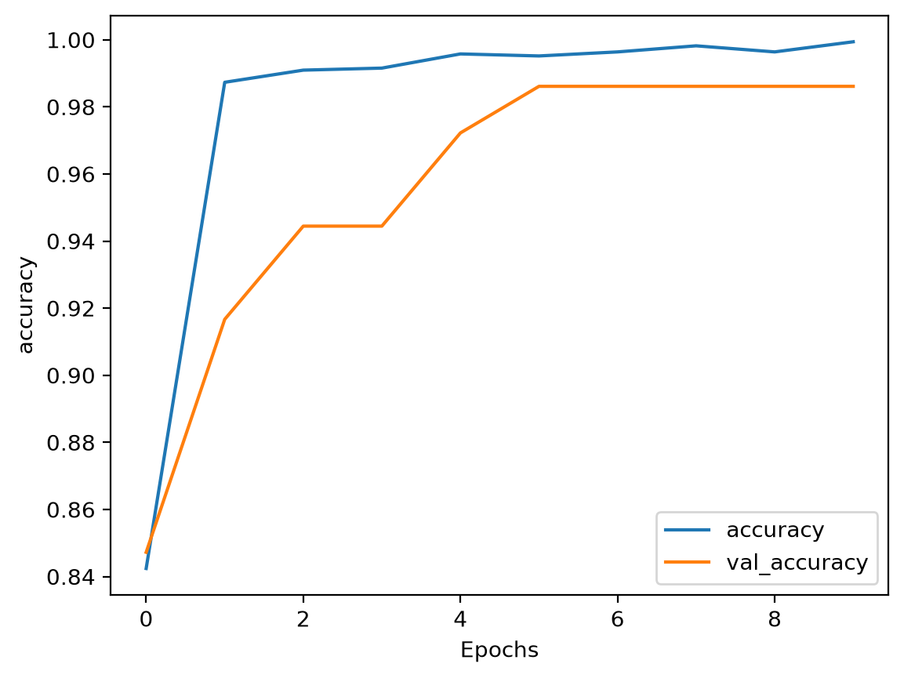
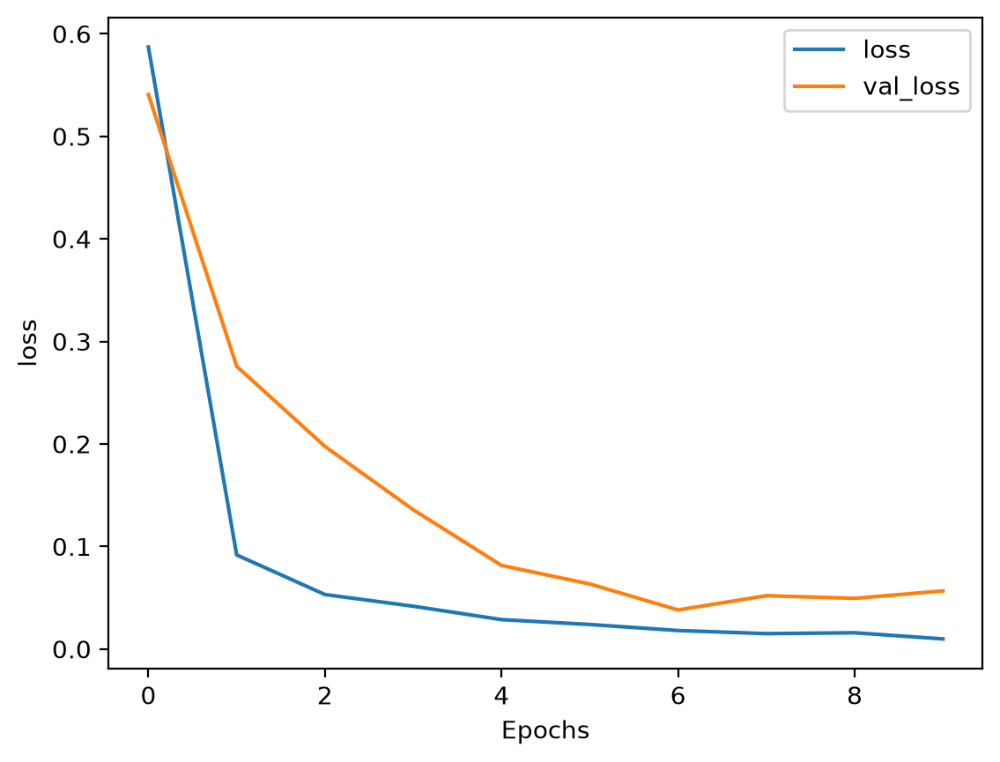
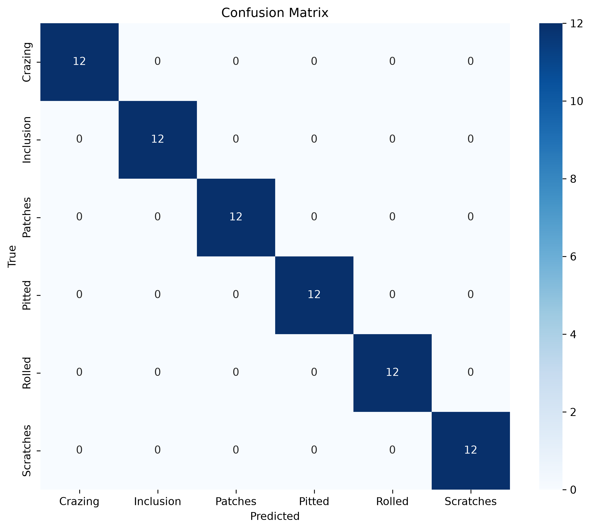

# NEU Metal Surface Defect Classification

A computer vision project for classifying metal surface defects using transfer learning with MobileNetV2 and TensorFlow/Keras.

## Overview

This project uses a pretrained convolutional neural network to classify steel surface images into six defect categories.

The project focuses on:
- Image classification
- Transfer learning
- Data augmentation
- Model evaluation

## Dataset

**NEU Metal Surface Defects Data**

Source: [Kaggle Dataset](https://www.kaggle.com/datasets/fantacher/neu-metal-surface-defects-data)

The dataset contains six defect categories:

- Crazing
- Inclusion
- Patches
- Pitted Surface
- Rolled-in Scale
- Scratches

The dataset is not included in this repository. Please download it from Kaggle.

### Dataset split

| Split | Images |
|---|---:|
| Training | 1,656 |
| Validation | 72 |
| Testing | 72 |
| **Total** | **1,800** |

## Model Architecture

MobileNetV2 pretrained on ImageNet was used as a feature extractor.

The classification head consists of:

1. Global Average Pooling
2. Dense layer (16 neurons, ReLU)
3. Dense layer (6 neurons, Softmax)

The pretrained base model was frozen during training.

## Training Configuration

| Parameter | Value |
|---|---|
| Model | MobileNetV2 |
| Input size | 224 × 224 |
| Batch size | 32 |
| Epochs | 10 |
| Optimizer | Adam |
| Loss | Categorical Crossentropy |
| Data augmentation | Rotation, shifts, horizontal flip |

## Results

Results from the reported training run:

| Metric | Result |
|---|---:|
| Final training accuracy | 99.94% |
| Final validation accuracy | 98.96% |
| Test accuracy | 100.00% |
| Test loss | 0.0228 |

### Training performance

### Confusion matrix

## Reproducing the Project

1. Clone this repository.
2. Install the required dependencies.
3. Download the dataset from Kaggle.
4. Rename the extracted dataset to data.
5. Run the Jupyter notebook.

## Limitations

The reported test accuracy is based on a test set of 72 images. Further evaluation on larger and independently collected datasets would be needed to assess generalization to real-world industrial inspection.

## Technologies

- Python
- TensorFlow / Keras
- MobileNetV2
- NumPy
- Scikit-learn
- Matplotlib
- Seaborn
